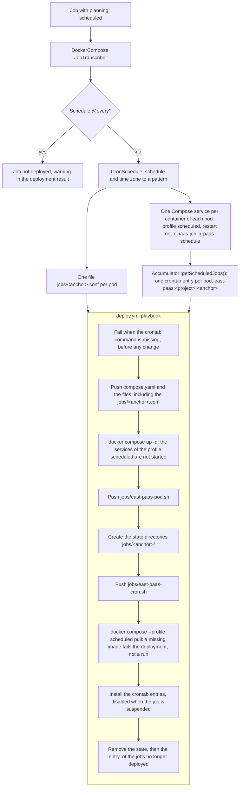
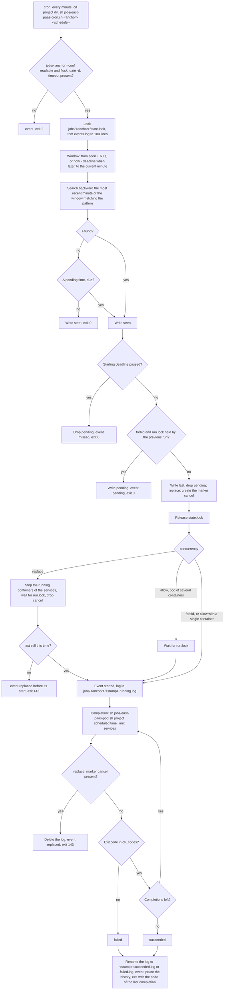
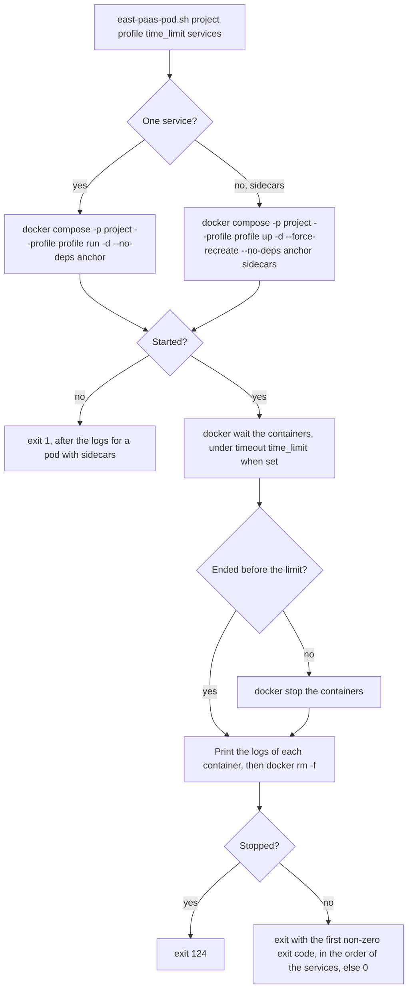

Teknoo Software - PaaS library - Scheduled jobs on the Docker Compose driver
===========================================================================

Introduction
------------

On Kubernetes, a job with `planning: scheduled` becomes a native `CronJob`. A plain Docker host has no such
object: the Docker Compose driver (`type: docker-compose`, see `documentation/docker-compose.deployment.md`)
rebuilds its behaviour from the **crontab of the SSH user** and **two shell scripts** pushed by the deploy
playbook:

* `jobs/east-paas-cron.sh`, the **runner of a scheduled job**: called every minute by the crontab entry of
  the job, it decides whether a run must start, like the `CronJob` controller of Kubernetes;
* `jobs/east-paas-pod.sh`, the **runner of a pod**: it runs one completion of the pod of a job and returns its
  exit code. It is shared with the during-deployment jobs.

Both scripts are written inline in `infrastructures/DockerCompose/templates/deploy.yml.template`
(`ansible.builtin.copy` with `content:`, mode `0750`), there is no separate file in the repository. They are
pushed again at each deployment: do not edit them on the host.

The `.paas.yaml` is the same as for Kubernetes:

```yaml
jobs:
    job-backup:
        planning: scheduled
        schedule: '0 */3 * * *'
        schedule-options:          #Optional, an option not defined keeps the default of Kubernetes
            time-zone: 'Europe/Paris'
            concurrency: forbid
            starting-deadline: 300
            successful-history: 3
            failed-history: 1
            suspend: false
        pods:
            backup:
                containers:
                    backup:
                        image: registry.hub.docker.com/backup
                        version: alpine
```

Workflow at the deployment
--------------------------



### What the transcriber produces

`JobTranscriber` (priority 32, deploy stage) emits each pod of the job like a pod of a deployment, with:

* one Compose service per container: the **anchor** `<job>-<pod>` holds the first container, each sidecar
  `<job>-<pod>-<container>` shares its network with `network_mode: "service:<anchor>"` (the job name is
  prefixed by the prefix of the project, when there is one). The `replicas` of the pod are ignored;
* the Compose profile **`scheduled`** (`AccumulatorInterface::SCHEDULED_PROFILE`) and `restart: "no"`, so
  `docker compose up` never starts them;
* the run settings under `x-paas-job` (completions, time limit, exit codes) and the schedule under
  `x-paas-schedule` (schedule, time zone, options). The `Accumulator` reads `x-paas-schedule` to build the crontab
  entry; the runners never read the `compose.yaml`, only the `.conf` file;
* the file `jobs/<anchor>.conf`, built by `ScheduledJobConfiguration::toShell()`.

A schedule `@every <duration>` is not a list of minutes: the job is **not deployed**, with a warning in the
deployment result. A schedule accepted by the `JobCompiler` but refused by Kubernetes (a reversed range like `5-1`)
fails the deployment.

### The configuration `jobs/<anchor>.conf`

One file per pod, shell variables quoted with `escapeshellarg()`, sourced by `east-paas-cron.sh`. It is pushed with
the other files of the project (mode `0640`), before `docker compose up`. For the `job-backup` above, deployed in the
Compose project `prod-my-app`:

```sh
project='prod-my-app'
services='job-backup-backup'
completions='1'
time_limit='0'
ok_codes='0'
concurrency='forbid'
time_zone='Europe/Paris'
pattern='^(00) (00|03|06|09|12|15|18|21) [0-9]{2} [0-9]{2} [0-6]$'
deadline='300'
successful_history='3'
failed_history='1'
```

| Variable             | Source                                             | Use                                                         |
|----------------------|----------------------------------------------------|-------------------------------------------------------------|
| `project`            | Compose project name                               | `docker compose -p` in `east-paas-pod.sh`                   |
| `services`           | the anchor, then its sidecars                      | services started for a completion, stopped by `replace`     |
| `completions`        | `completions.count` of the job, `1` by default     | number of sequential runs of the pod for a scheduled time   |
| `time_limit`         | `completions.time-limit` of the job, `0` for none  | time limit of **each** completion                           |
| `ok_codes`           | `completions.success-on` of the job, `0` by default | exit codes accepted for a completion                       |
| `concurrency`        | `schedule-options.concurrency`, `allow` by default | `allow`, `forbid` or `replace`                              |
| `time_zone`          | `schedule-options.time-zone`                       | zone of the schedule, empty for the zone of the host        |
| `pattern`            | the schedule, see below                            | minutes matching the schedule                               |
| `deadline`           | `schedule-options.starting-deadline`               | seconds to start a scheduled time, empty for no deadline    |
| `successful_history` | `schedule-options.successful-history`, `3`         | logs of succeeded runs kept                                 |
| `failed_history`     | `schedule-options.failed-history`, `1`             | logs of failed runs kept                                    |

`suspend` is not in the file: it disables the crontab entry.

### The crontab entry

One entry per pod in the crontab of the SSH user, installed with `ansible.builtin.cron` (its name is the
`#Ansible: east-paas:<project>:<anchor>` comment above the line):

```
#Ansible: east-paas:prod-my-app:job-backup-backup
* * * * * cd /opt/paas/prod-my-app && PATH=/usr/local/bin:/usr/bin:/bin sh jobs/east-paas-cron.sh \
    'job-backup-backup' '0 */3 * * *' >>'jobs/job-backup-backup/events.log' 2>&1
```

(on a single line in the crontab). The entry runs **every minute**, not on the schedule of the job:

* the cron of Debian ignores `CRON_TZ`, the time zone of the job could not be honoured;
* an entry on the schedule could not catch up a time missed while the host was down, keep a time pending with
  `forbid`, nor honour a starting deadline.

The schedule in the entry is only informative, for an operator reading the crontab; the runner reads the pattern of
the `.conf`. `PATH` is set because the one of cron is minimal. An entry containing a `%` (a newline for cron, even
between quotes) or a line break fails the deployment.

When the job is suspended, the entry is installed **disabled** (commented out). The `.conf` is still pushed, for the
resume.

### Removal of a job

At each deployment, the playbook reads the crontab, lists the entries `east-paas:<project>:…` no longer deployed and
removes, in this order, their state (`jobs/<anchor>/` and `jobs/<anchor>.conf`) then their entry. The state is
removed first: an entry left by an interrupted deployment still leads the next one to its state. Without its state, a
job deployed again starts like a new `CronJob`: it does not catch up the times since its removal.

The entries of a **deleted environment** are never reached by a deployment and stay in the crontab: remove them by
hand (see [Operating](#operating-the-scheduled-jobs)).

From the schedule to the pattern
--------------------------------

`CronSchedule` translates the schedule (the syntax of Kubernetes, read by `robfig/cron` v3: 5 fields, names of months
and days, `?`, ranges, lists, steps, descriptors `@hourly` to `@yearly`) into a regular expression. At each tick, the
runner formats the minute to test with `date '+%M %H %d %m %w'`, in `TZ=<time zone>` when the job has one, else in the
zone of the host, and matches it with `grep -E`:

| Schedule         | Pattern                                                                 |
|------------------|-------------------------------------------------------------------------|
| `17 3 * * *`     | `^(17) (03) [0-9]{2} [0-9]{2} [0-6]$`                                   |
| `0 */3 * * *`    | `^(00) (00\|03\|06\|09\|12\|15\|18\|21) [0-9]{2} [0-9]{2} [0-6]$`       |
| `@weekly`        | `^(00) (00) [0-9]{2} [0-9]{2} (0)$`                                     |
| `05 03 01 02 00` | `^(05) (03) (01) (02) [0-6]$\|^(05) (03) [0-9]{2} (02) (0)$`            |

Like `robfig/cron`, when the day of month or the day of week is a star field (`*` or `?` without a step above 1),
both must match; when both are restricted, either matches: the last schedule runs at 03:05 on February 1st **and** on
each Sunday of February.

Workflow of a tick: `east-paas-cron.sh`
---------------------------------------

Every minute, cron runs the runner of each job from the project directory. The runner finds the most recent scheduled
time not started yet and starts it, or does nothing.



### The window and the catch up

* `seen` is the last minute examined. The window starts at `seen + 60` seconds: the minutes missed since the last
  tick (cron stopped, host down) are examined, and only the **most recent** matching one is started, like Kubernetes.
* With a `starting-deadline`, the window never starts before `now - deadline`: an older time is ignored, and a found
  time not started within the deadline is reported **missed**.
* Without `seen` (first tick of a new job, or a job deployed again after its removal), only the current minute is
  examined: a new job does not catch up the past.
* `seen` in the future (clock set back) is reset to the previous minute.
* A time kept `pending` by `forbid` starts when no newer time is found; a newer time replaces it.

### Concurrency

| `concurrency`     | A run is still running at the next scheduled time                                                                                                                                                                                                                                                                                                                  |
|-------------------|------------------------------------------------------------------------------------------------------------------------------------------------------------------------------------------------------------------------------------------------------------------------------------------------------------------------------------------------------------------------------------|
| `allow` (default) | Pod of a single container: both run, in two one-off containers. Pod of several containers: the new run waits for the end of the previous one (`run.lock`), `up --force-recreate` would kill the running pod.                                                                                                                                                         |
| `forbid`          | The new time is written in `pending`. It starts at the first tick after the end of the previous run, up to 60 seconds later, if no newer time and no deadline overtook it.                                                                                                                                                                                              |
| `replace`         | The new run creates the marker `cancel`, stops the containers of the services of the job and waits for `run.lock`. The previous run sees the marker at the end of its completion, deletes its log and exits with `143`: it is not kept in the history. When several runs wait for the lock, an older one woken first sees `last` changed and exits before its start. |

### Exit codes of `east-paas-cron.sh`

Written in `events.log` with the outcome, useful when the runner is called by hand:

| Code  | Meaning                                                                                                |
|-------|--------------------------------------------------------------------------------------------------------|
| `0`   | nothing to start, a time missed or a time kept pending                                                 |
| `1`   | a lock could not be taken                                                                              |
| `2`   | the `.conf` or a required tool is missing (`flock`, `date -d @<seconds>`, `timeout`)                   |
| `143` | the run was replaced by a newer one (`replace`)                                                        |
| other | the run ended, with the exit code of its last completion: succeeded when it is in `ok_codes`, else failed |

Workflow of a completion: `east-paas-pod.sh`
--------------------------------------------

Called with `<project> <profile> <time limit> <anchor> [<sidecar>...]`, with the profile `scheduled` by the runner of
a scheduled job, `jobs` by the deploy playbook for a during-deployment job.



* The pod is started **detached then waited for**, not with `docker compose run --rm`: the `SIGTERM` sent by
  `timeout` to the Compose client would leave the container running.
* `--no-deps`: the dependencies (the init services of the populated volumes) were completed by the `up` of the stack.
* A sidecar can not join the network of a one-off container of `run`: a pod with sidecars is started with `up`, as
  regular containers, recreated so a container left by a previous run is never reused. A sidecar which never exits
  keeps its pod running until the time limit, like a sidecar of a Kubernetes `Job`.
* The logs of a pod of several containers are prefixed by `east-paas: <service>` for each container.

Files on the Docker host
------------------------

Under `<deploy_root>/<project>/` (`teknoo.east.paas.docker-compose.deploy_root`, `/opt/paas` by default):

```
compose.yaml                         services of the profile scheduled, x-paas-job, x-paas-schedule
jobs/
├── east-paas-pod.sh                 runner of a completion of a pod (0750)
├── east-paas-cron.sh                runner of a scheduled job (0750)
├── <anchor>.conf                    configuration of the job (0640)
└── <anchor>/                        state of the job (0750)
    ├── events.log                   output of the crontab entry, one line per event, last 100 lines kept
    ├── seen                         last minute examined (epoch seconds)
    ├── last                         last scheduled time started (epoch seconds)
    ├── pending                      time kept pending by forbid (epoch seconds)
    ├── state.lock                   lock of the state, held while a tick decides
    ├── run.lock                     lock of the run (forbid, replace, allow with sidecars)
    ├── cancel                       marker of a replacement in progress (replace)
    ├── <stamp>.running.log          output of the run in progress
    ├── <stamp>.succeeded.log        output of a succeeded run, successful_history kept
    └── <stamp>.failed.log           output of a failed run, failed_history kept
```

`<stamp>` is the scheduled time in UTC, `20261019T150000Z`: the logs sort in chronological order and the oldest are
pruned first. A line of `events.log` is `<UTC date> <stamp>: <event>`, with the events `started`,
`succeeded, exit code <n>`, `failed, exit code <n>`, `missed, …`, `pending, …`, `replaced by a newer run` and
`replaced by a newer run before its start`.

Schedule options, compared to Kubernetes
----------------------------------------

| `schedule-options`   | Kubernetes `CronJob`               | Docker Compose                                                                                          |
|----------------------|------------------------------------|---------------------------------------------------------------------------------------------------------|
| `time-zone`          | `spec.timeZone`                    | the minute is formatted in `TZ=<zone>`; without, in the zone of the host (`tzdata` required for a zone) |
| `concurrency`        | `spec.concurrencyPolicy`           | see [Concurrency](#concurrency)                                                                         |
| `starting-deadline`  | `spec.startingDeadlineSeconds`     | bounds the catch up window; a time not started within it is missed                                      |
| `successful-history` | `spec.successfulJobsHistoryLimit`  | logs of succeeded runs kept, `3` by default                                                             |
| `failed-history`     | `spec.failedJobsHistoryLimit`      | logs of failed runs kept, `1` by default                                                                |
| `suspend`            | `spec.suspend`                     | crontab entry disabled; once resumed, the most recent time missed is started, within the deadline       |

Differences with Kubernetes:

* a pending `forbid` time starts up to 60 seconds after the end of the previous run;
* the runs of a pod of several containers never overlap, even with `allow`;
* a schedule `@every <duration>` is not deployed, with a warning in the deployment result;
* like for the during-deployment jobs, `is-parallel` is not supported (the completions are sequential), the time
  limit applies to each completion, a failed completion is not retried, and the success exit codes replace `0`;
* the entries of a deleted environment stay in the crontab.

Kubernetes is unaffected and keeps using its native `CronJob`.

Host prerequisites
------------------

In addition to the prerequisites of the driver (see `documentation/docker-compose.deployment.md`), on the Docker
host:

* a cron daemon with the `crontab` command for the SSH user (`cron` on Debian / Ubuntu, `cronie` on RedHat). Without
  it, a deployment with scheduled jobs fails before any change;
* `flock` (util-linux);
* a `date` accepting `-d @<seconds>` (GNU coreutils or busybox);
* `timeout` (coreutils) for a job with a time limit;
* `tzdata` for a job with a time zone;
* the `docker` CLI in `/usr/local/bin`, `/usr/bin` or `/bin` (the `PATH` of the entry).

A missing tool is reported in `events.log`, the run is not started.

Operating the scheduled jobs
----------------------------

From the project directory (`cd <deploy_root>/<project>`), as the SSH user:

* **list the entries**: `crontab -l`, the entries of the project are named `#Ansible: east-paas:<project>:<anchor>`;
  a disabled (suspended) entry is commented out;
* **follow a job**: `tail jobs/<anchor>/events.log`, the outputs of the runs are in `jobs/<anchor>/*.log`;
* **run a tick by hand**: `sh jobs/east-paas-cron.sh '<anchor>' '<schedule>'` behaves like the crontab entry, its
  events are printed instead of appended to `events.log`: it starts a run only when a scheduled time is due;
* **run the pod now**, outside the schedule and without history:
  `sh jobs/east-paas-pod.sh '<project>' scheduled <time limit> <anchor> [<sidecar>...]`. For a pod with sidecars,
  not while a run is in progress: its `up --force-recreate` would kill it;
* **suspend or resume** a job: set `suspend` in the `.paas.yaml` and deploy again, an entry edited by hand is
  restored by the next deployment;
* **clean a deleted environment**: with `crontab -e`, remove each `#Ansible: east-paas:<project>:<anchor>` line and
  the line following it, then `rm -rf jobs/<anchor> jobs/<anchor>.conf` (or the whole project directory).

See also
--------

* `documentation/docker-compose.deployment.md` — the Docker Compose driver, its playbooks and its configuration.
* `documentation/example.paas.1.2.md` — the syntax of the jobs and of the `schedule-options` in the `.paas.yaml`.
